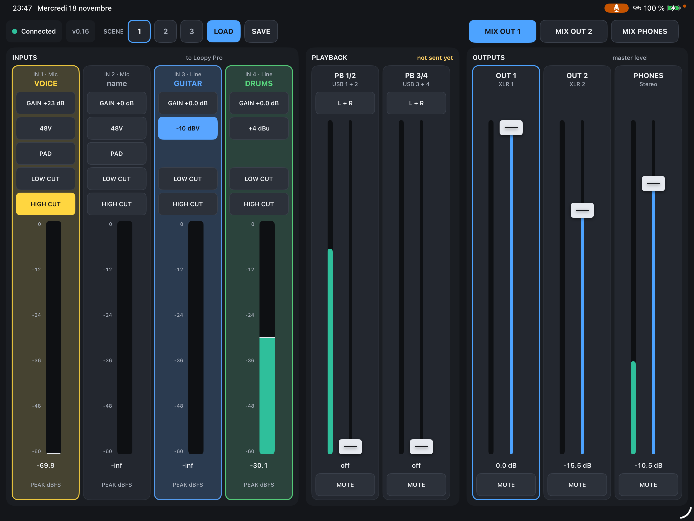
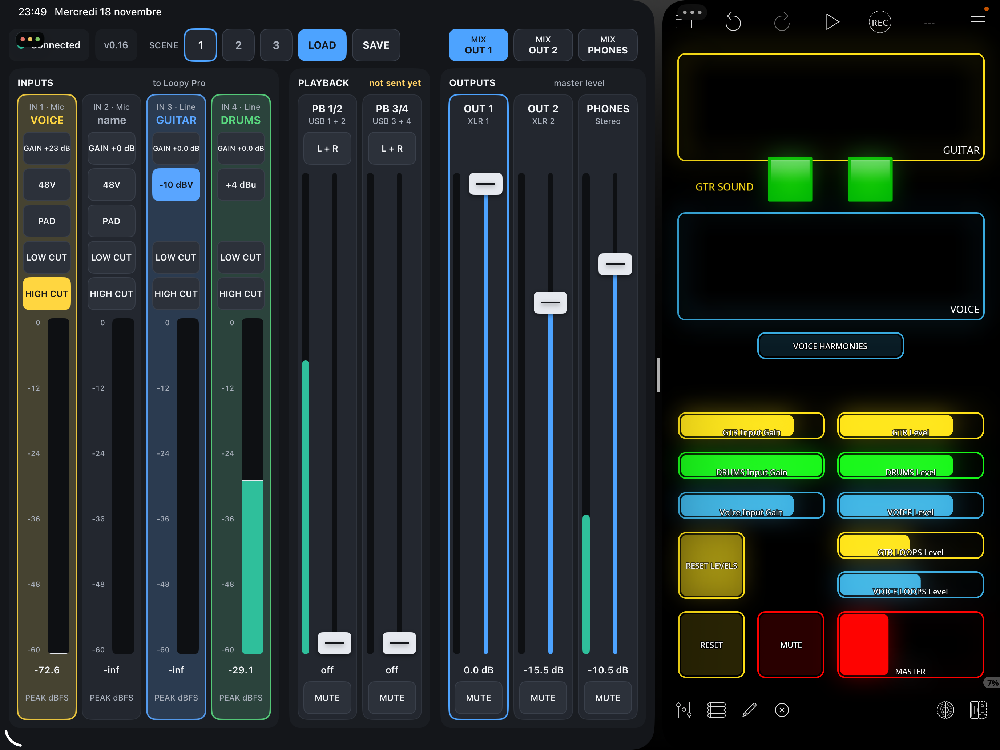

# OliSimpleRME

A small iPad mixer for the **RME Babyface Pro FS** in class-compliant mode, made to sit next to **Loopy Pro** on stage. It replaces TotalMix FX for the handful of settings a solo looping rig needs, and nothing more.

Side by side with Loopy Pro:

> Personal project, shared as a starting point. Not affiliated with or endorsed by RME. It was tested on one Babyface Pro FS only. Use it at your own risk, and take care with 48V: phantom power can damage gear that is not built for it.

## What it does

**Inputs (IN 1 to 4): preamp strips**
- Gain on every input (mic 1/2, line 3/4)
- 48V and PAD on the mic inputs; +4 dBu / -10 dBV on the line inputs
- LOW CUT (80 Hz, 12 dB per octave) and HIGH CUT (10 kHz) per input; the filters also apply to what Loopy Pro records
- Large peak meter with peak hold
- A name (up to 8 letters) and a column colour per input
- No input faders: inputs go to the iPad over USB, and monitoring happens in Loopy Pro

**Playback (what the iPad sends back)**
- Two stereo pairs, PB 1/2 and PB 3/4, each with fader, meter and mute (the fader position is remembered)
- On the mono outputs, each pair can send L + R, left only or right only

**Outputs**
- OUT 1 (XLR 1), OUT 2 (XLR 2) and PHONES (stereo): level, meter, mute
- One independent mix per output; tap an output column or its MIX button to see that mix

**Scenes**
- Three scenes stored in the app: mix, output levels, gains, input settings, filters
- Pick a slot, then LOAD sends it to the unit and SAVE stores into it
- Nothing is sent at launch, so opening the app never overwrites a TotalMix setup
- Recalling a scene that would switch 48V on asks for confirmation first

**Diagnostics**
- Tap the version number: MIDI port pickers, raw state, meters as numbers, message log

## What it does not do

- BOOST on IN 3/4, full EQ, reverb/echo, loopback, ADAT channels, Dim
- It cannot read the mixer or the EQ back from the unit (the unit does not report them), so the app is the master of the mix once you press LOAD
- It cannot run at the same time as TotalMix FX: TotalMix re-sends its own state when it opens
- It is a standalone app, not an AUv3

## Build it

1. You need a Mac with **Xcode 27** or later (the project uses the new `project.xcproj` format) and an iPad on **iPadOS 26** or later.
2. Open `BabyfaceProbe.xcodeproj`. (The Xcode project kept its working name; the app shows up as OliSimpleRME.)
3. In the target's *Signing & Capabilities*, choose your own team.
4. Connect the iPad, pick it as the destination and press Run.
5. Put the Babyface Pro FS in class-compliant mode and plug it into the iPad. The app talks to it on the unit's **MIDI port 2**; if it does not connect, open Diagnostics and select port 2 for both source and destination.

## How it works

The unit is controlled with SysEx messages on its second MIDI port: `F0 00 20 0D 10  <32-bit words as five 7-bit bytes> F7`.

| File | Role |
| --- | --- |
| `BabyfaceCodec.swift` | Builds and parses the messages: levels, gains, input settings, mixer cells, filters, meters |
| `MIDIEngine.swift` | CoreMIDI: ports, SysEx send and receive |
| `ProbeModel.swift` | Connection, polling, guarded writes of the input settings |
| `MixerStore.swift` | The mix, scenes, names and colours, and what gets sent to the unit |
| `MixerView.swift` | The SwiftUI mixer screen |
| `ContentView.swift` | The Diagnostics screen |

## Credits

The control protocol is not documented by RME. This app relies on the reverse-engineering work published in:

- [ultracello/loopy-pro-rme-interface-control](https://github.com/ultracello/loopy-pro-rme-interface-control), which this project started from
- [oscmix](https://github.com/michaelforney/oscmix) by Michael Forney

The code was written with Claude (Anthropic).

## Licence

MIT. See [LICENSE](LICENSE).
